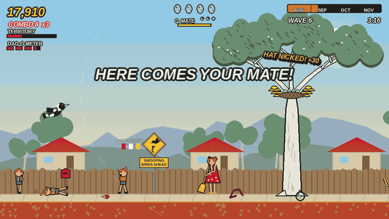
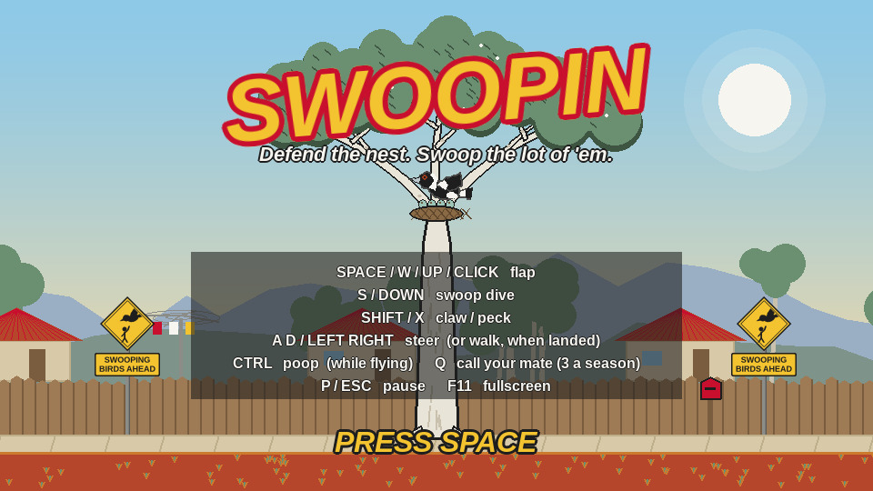
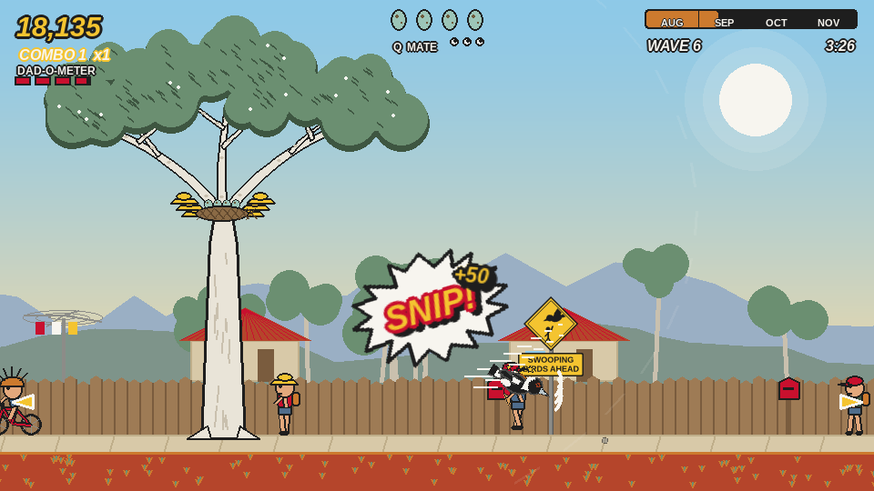
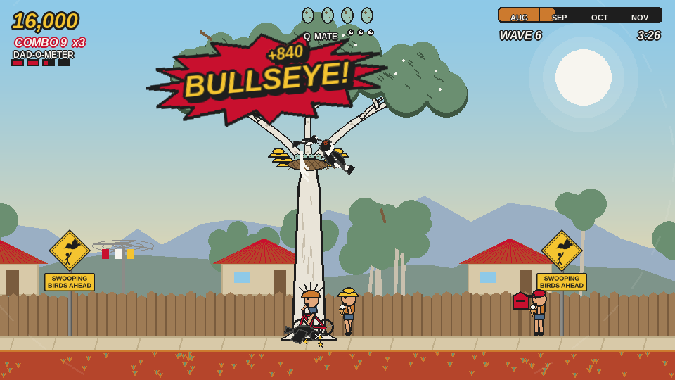
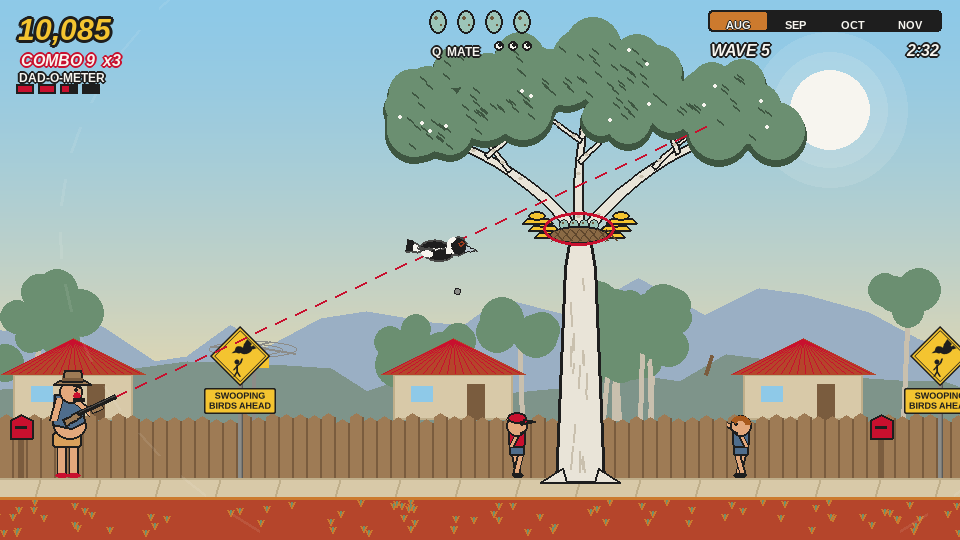
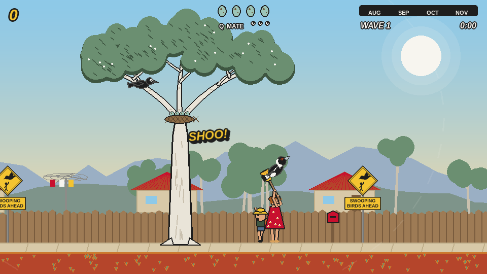
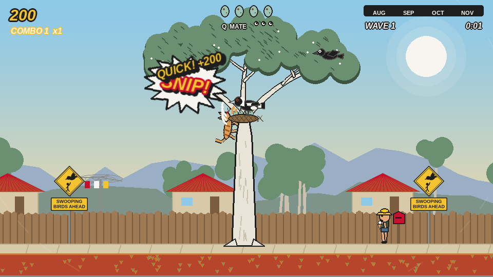
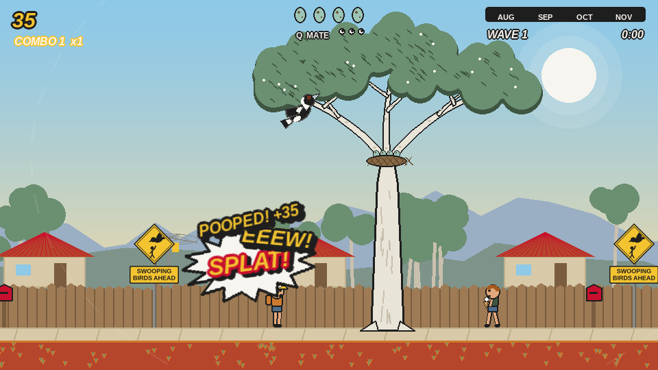
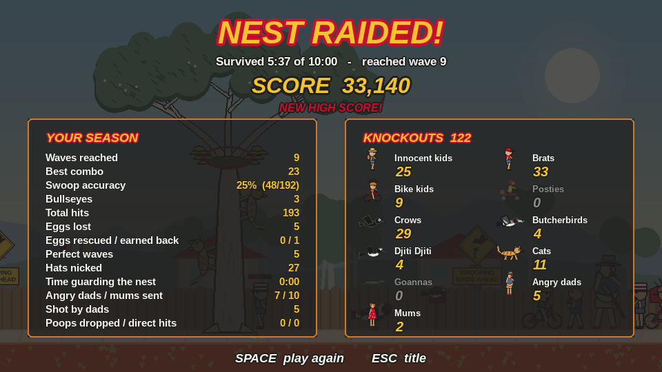

# Swoopin



It's spring in an Aussie suburb, you're a magpie, and everyone is after your
eggs. Flap Flappy Bird-style around your gum tree and swoop the brats,
posties, crows, butcherbirds, Djiti Djiti (willie wagtails), cats and goannas
that come from every direction. Most attackers go down in one good hit, landing
with a comic-book **BANG!**, **CLAWED!** or **BULLSEYE!**. Kids go down with X's
for eyes.

Most kids are just walking past, terrified of you. Swooping them anyway gets
you a cheeky bonus and sends them screaming for mum. Hit too many and an
**angry dad with a shotgun** comes looking for you.

Survive the full 10-minute swooping season (Aug → Nov) and the chicks fledge.
Lose every egg and the nest is raided.

**[▶ Play it in your browser](https://wufle.github.io/swoopin/)** (keyboard needed;
click the page once to start, which lets the browser play sound), or
[download it](#download) for Windows, macOS or Linux. The download plays a
little better: it starts instantly, runs more smoothly, handles sound more
reliably, and lets you use Ctrl to poop and switch fullscreen in game.

## Screenshots

| | |
|---|---|
|  |  |
| **Title screen.** The gum tree, the nest and the controls. | **Swoop!** Every hit lands a comic-book word. |
|  |  |
| **Bullseye.** Eye hits are worth 5×. | **Angry dad.** Hit too many kids and he comes out, taking slow, visible aim. |
|  |  |
| **"SHOO!"** Mums protect their kids with a broom. | **On guard.** Perch in the nest and claw raiders off the trunk. |
|  |  |
| **Poop** (Ctrl). "EEEW!" | **Season stats.** Accuracy, combos, eggs, and a knockout tally. |

## Download

Ready-to-play builds for Windows, macOS (Apple Silicon) and Linux are on the
[Releases page](https://github.com/wufle/swoopin/releases). Unzip and run;
no Python needed.

- **Windows:** SmartScreen may warn about an unrecognised app. Click "More
  info", then "Run anyway".
- **macOS:** the app isn't signed. Right-click Swoopin.app, choose Open, then
  Open again (only needed the first time).
- **Linux:** `tar xzf swoopin-linux-x86_64.tar.gz && ./swoopin`

## Run from source

```sh
python3 -m venv .venv
source .venv/bin/activate
pip install -r requirements.txt
```

Then:

```sh
python -m swoopin               # --mute for no sound
python -m swoopin --fullscreen  # or --windowed; F11 / Alt+Enter toggles in game
```

Full screen is remembered between runs. The game renders at 960×540 and
scales crisply: exactly 2× at 1080p and 4× at 4K, with letterboxing on other
aspect ratios.

## Controls

| Key | Action |
|---|---|
| Space / W / Up / left-click | Flap (gravity always pulls you down) |
| S / Down / right-click | Swoop dive in the facing direction. A hit bounces you back up to chain combos |
| Shift / X | Claw: short-range slash. Does double damage to climbers on the trunk |
| Ctrl / E | Poop (while flying). In the browser use E, since Ctrl+W closes the tab |
| Q | Call your mate: a partner magpie flies in and swoops raiders for 10 seconds. Three calls a season |
| A D / Left Right | Steer and turn in the air, or walk on two legs once you've landed |
| P / Esc | Pause (Q while paused quits to the title screen instead) |
| F1 | Debug overlay (difficulty, spawn stats) |
| F11 / Alt+Enter | Toggle fullscreen |

## Scoring

- Hits to the body score ×1, head ×2, the back of a cable-tie helmet ×3, and
  an **eye ×5**. An eye hit knocks a kid out straight away.
- Hits chained without touching the ground build a combo multiplier, up to ×5.
- You get bonus points for knockouts, for a knockout within a second of an
  attacker appearing, for nicking a kid's hat (it goes in your nest), for
  getting a stolen egg back, and for perfect waves. A perfect wave also gives
  back a lost egg.
- Swooping an innocent kid earns a **CHEEKY!** bonus but fills the
  **DAD-O-METER**. When it's full, an angry dad marches in, takes slow, visible
  aim (a dashed red line that locks just before he fires), and lets fly with a
  shotgun spread. Get out of the line, or swoop him to spoil his aim. He takes
  three hits.
- **Poop** with Ctrl while flying (with a little fart). A splat on a kid's
  head gets an "EEEW!", and the kid runs home to wash it off. That counts as
  dealing with them but isn't a knockout, so no angry dads. It sends brats
  away from the tree, spoils a dad's aim, and stings animals a little.
- Sometimes a **mum** comes running to a knocked-out kid and stands guard,
  or walks along with one. Come too close and she yells **"SHOO!"** and
  swings a broom at you. Knocking out a mum gets you a cheeky bonus, but
  really winds up the dads.
- Land on the footpath (it never hurts) and you can walk around on two legs and
  peck at shins. Landing ends your combo.
- **Land in the nest to stand guard.** Drop gently onto it and the magpie
  stands among the eggs. Shuffle along the rim, claw down at cats and goannas
  topping the trunk, and slash crows that come for the eggs. Raiders right at
  the nest work half as fast while you're sitting on it. Flap to take off, or
  walk off the edge. A swoop passes straight through the nest, so dives at
  raiders still land.
- Flying too far from the nest drains your territory meter and drags you back.
- At the end of every game, a stats screen shows your season: swoop accuracy,
  bullseyes, best combo, eggs lost and rescued, hats nicked, time spent
  guarding the nest, times you got shot, and a knockout tally for every
  attacker type.

## Record your own sounds

Plug in a mic and run:

```sh
python -m swoopin.record threat     # the dad's line as he takes aim
python -m swoopin.record shoo       # a mum shooing the magpie
python -m swoopin.record eew        # a kid who's just been pooped on
python -m swoopin.record --list     # every sound name and what it's for
```

You get a 3-2-1 countdown and then 3 seconds of recording (change it with
`--seconds 4`). The take is trimmed to where you start talking, levelled,
saved into `swoopin/sounds/` and played back. Record several takes of the
same name and the game picks between them at random. `--replace` throws away
your earlier takes of that name. The game uses `threat` and `shoo` as soon as
you've recorded them; you can record over any other sound name too.

## Code layout

All the art is drawn in code. The sounds are real recordings: Australian
magpies and ravens, a willie wagtail, kids, dads and a shotgun. They come from
Wikimedia Commons and Freesound under CC0 and CC BY-SA 4.0, with full credits
in [`swoopin/sounds/CREDITS.md`](swoopin/sounds/CREDITS.md).
`swoopin/tuning.py` holds every gameplay and difficulty number, and
`swoopin/palette.py` holds every colour. See `PROMPT.md` for the full design.

```
swoopin/
  main.py      game loop, scenes, game rules
  magpie.py    flappy physics, swoop/claw, territory leash
  threats.py   every attacker type, hit zones, AI
  hits.py      hit classification, damage, scoring, comic words
  spawner.py   season clock, difficulty curve, waves, directions
  fx.py        comic text bursts, particles, props, screen shake
  level.py     parallax background, gum tree, nest
  hud.py       score, eggs, territory, season calendar, edge arrows
  stats.py     end-of-game statistics
  record.py    record your own sounds into the game
  art.py       all sprite drawing
  audio.py     sound playback (recordings + a few synth blips)
  sounds/      the recordings, with CREDITS.md
```

## Building executables

```sh
pip install pyinstaller
pyinstaller packaging/swoopin.spec   # -> dist/
./dist/swoopin --selftest            # headless check: plays 20 s, reports sounds loaded
```

The browser version is built with [pygbag](https://github.com/pygame-web/pygbag)
(Python and pygame-ce compiled to WebAssembly):

```sh
pip install pygbag numpy
./web/build.sh                               # -> build/web/
python -m http.server -d build/web 8080     # open http://127.0.0.1:8080
```

Every push to master redeploys it to GitHub Pages (`.github/workflows/web.yml`).
Publishing a GitHub release builds and attaches Windows, macOS and Linux
versions automatically (`.github/workflows/build-executables.yml`).
